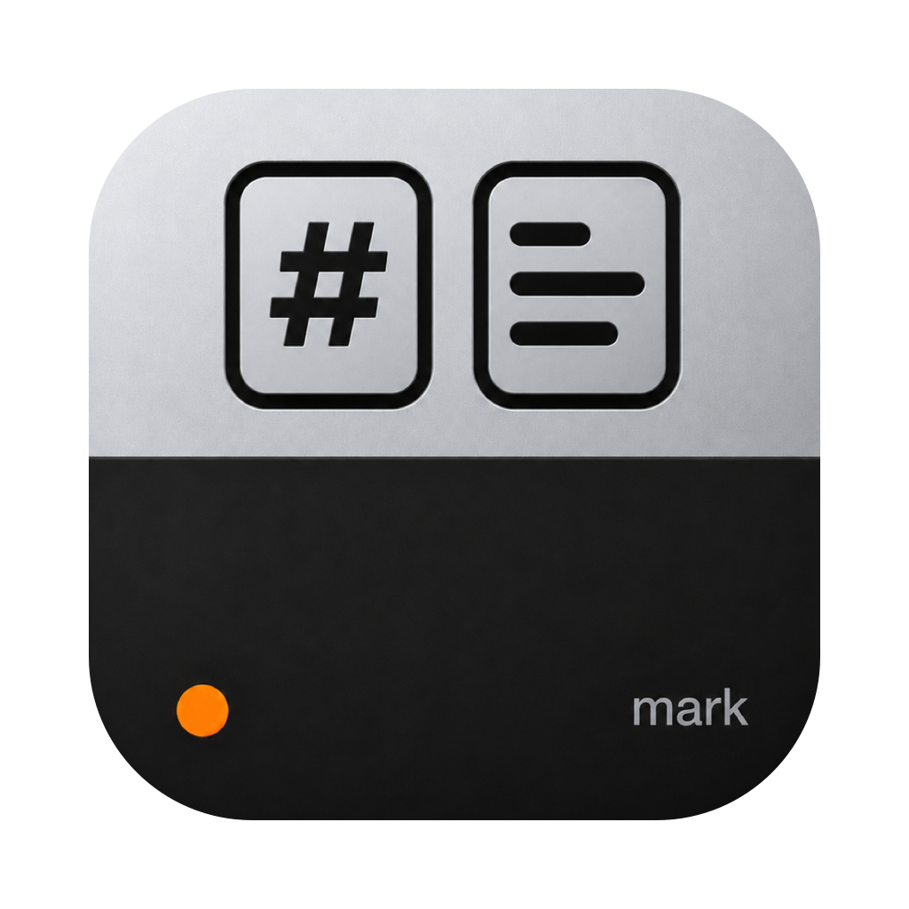

# Code[Mark] for Mac

Notarized downloads of **Code[Mark] for Mac** — open a Markdown file already
formatted, edit it like a document, and save back to the same `.md` file
without rewriting the parts you didn't touch.

## Download

**[Download from Releases](https://github.com/miguelriotinto/codemark-app/releases)** — `CodeMark-<version>.dmg` under Assets
(0.1 is a beta, marked as a pre-release)

Open the DMG and drag **Code[Mark]** to **Applications**. It is signed with
Developer ID and notarized by Apple, so it opens without a Gatekeeper warning.
Requires macOS 26 or later.

Every release lists its version, build number and SHA-256. The Mac app is
distributed only here. The iPhone and iPad apps come through TestFlight and the
App Store.

## Source and issues

Source lives in [miguelriotinto/CodeMark](https://github.com/miguelriotinto/CodeMark).
This repository only hosts the Mac app's downloads.
