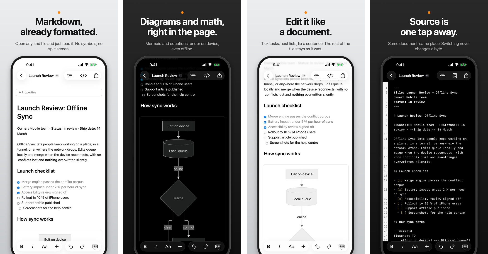
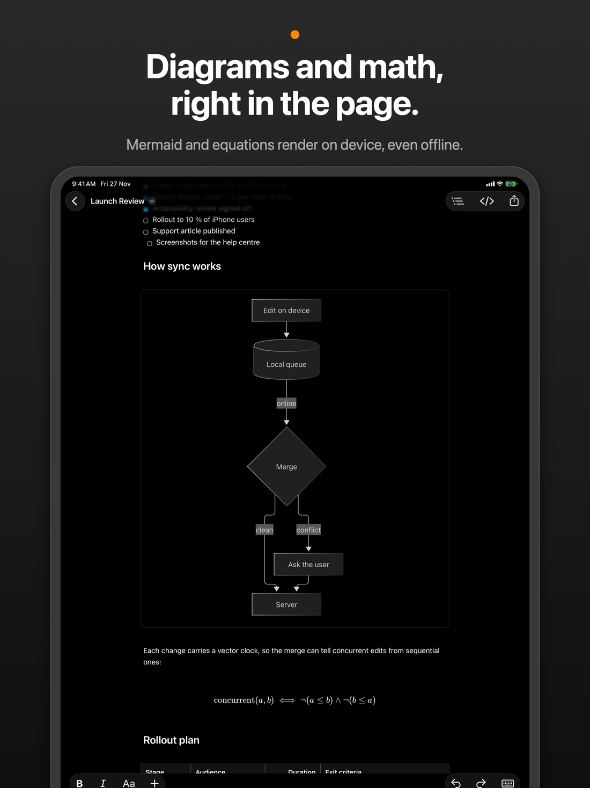
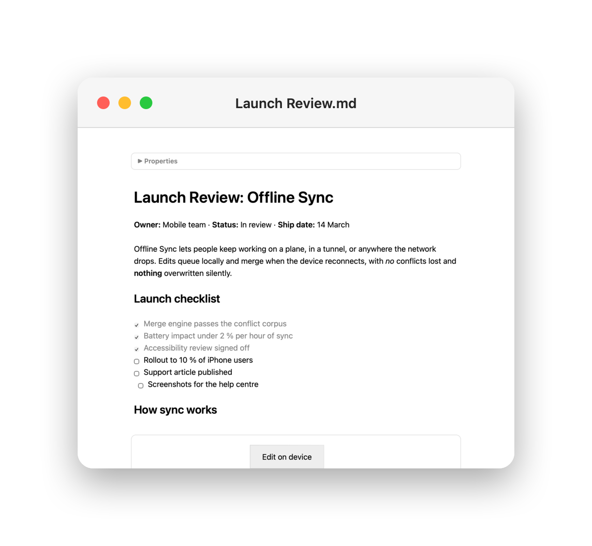

<p align="center">
  
</p>

<p align="center">
  <picture>
    <source media="(prefers-color-scheme: dark)" srcset=".github/lockup-dark.svg">
    
  </picture>
</p>

<h3 align="center">Open Markdown like a document. Save it like you never touched the rest.</h3>

<p align="center">
  <a href="https://apps.apple.com/app/id6839596700"><b>iPhone &amp; iPad — App Store</b></a>
  &nbsp;·&nbsp;
  <a href="https://github.com/miguelriotinto/codemark-app/releases"><b>Mac — download the DMG</b></a>
  &nbsp;·&nbsp;
  <a href="SUPPORT.md">Support</a>
  &nbsp;·&nbsp;
  <a href="PRIVACY.md">Privacy</a>
</p>

<p align="center">
  
</p>

---

**Code[Mark]** opens a `.md` file already formatted and ready to edit — headings,
lists, tables, diagrams and equations, with the Markdown symbols out of the way.
Change a sentence, tick a task, close it: the original file now contains exactly
that change, and every other byte is as it was. It stays an ordinary Markdown file,
wherever you keep it.

Built for two jobs: **reading** a technical document without reading its markup,
and **editing** a file that someone else — or some tool — wrote, without
reformatting it behind their back.

## What it does

|  |  |
|---|---|
| **Formatted, editable, at once** | No preview pane and no edit mode. The document opens formatted; tap and type. |
| **Your file stays your file** | Edits change only what you changed. Line endings, indentation, list markers, front matter, comments and reference links are kept byte for byte. |
| **Diagrams and math** | Mermaid diagrams and LaTeX equations render in place, on device, even offline. |
| **Tables, tasks and lists** | Edit table cells, add rows and columns, tick checkboxes, nest lists with Tab. |
| **Source is one tap away** | Switch to the raw Markdown and back at the same spot. Switching never changes a byte. |
| **Images inside the file** | Paste a photo and it travels with the `.md` file — no folder of attachments. |
| **Safe with other apps** | If another app changes the file while you have unsaved edits, Code[Mark] keeps both versions and asks which to keep. Nothing is overwritten silently. |
| **Print and PDF** | Export the formatted document to a paginated PDF: full tables, diagrams and equations. |
| **Opens files where they live** | Files, iCloud Drive, Finder, any folder. No library, no import, no account. |

<p align="center">
  
</p>

## Get it

### iPhone and iPad

**[Code[Mark] on the App Store](https://apps.apple.com/app/id6839596700)** — free. Requires iOS / iPadOS 26.

### Mac

**[Download from Releases](https://github.com/miguelriotinto/codemark-app/releases)** — `CodeMark-<version>.dmg` under *Assets*.

Open the DMG and drag **Code[Mark]** to **Applications**. It is signed with
Developer ID and notarized by Apple, so it opens without a Gatekeeper warning.
Requires macOS 26 on Apple silicon or Intel.

<p align="center">
  <picture>
    <source media="(prefers-color-scheme: dark)" srcset=".github/mac-dark.png">
    
  </picture>
</p>

<details>
<summary><b>Verify a download</b></summary>

Every release lists its version, build number and SHA-256. To check yours:

```bash
shasum -a 256 ~/Downloads/CodeMark-*.dmg          # compare with the release notes
spctl --assess --type open --context context:primary-signature -v ~/Downloads/CodeMark-*.dmg
```

`spctl` should say `accepted` and `source=Notarized Developer ID`.
</details>

## Markdown support

CommonMark plus the GitHub flavour most technical documents use: tables, task
lists, strikethrough, autolinks, footnotes and alerts (`> [!NOTE]`), with Mermaid
diagrams and `$…$` / `$$…$$` math as extensions. YAML front matter, HTML comments
and anything Code[Mark] can't edit safely are kept untouched and shown as source.
Raw HTML is never executed.

## Keyboard

| | Mac and iPad keyboard |
|---|---|
| Bold, italic, code | ⌘B · ⌘I · ⌘E |
| Link | ⌘K |
| Heading 1–3 · paragraph | ⌥⌘1–3 · ⌥⌘0 |
| Bulleted · numbered · task list | ⇧⌘8 · ⇧⌘7 · ⇧⌘9 |
| Indent · outdent list item | Tab · ⇧Tab (or ⌘] · ⌘[) |
| Show source | ⌥⌘U |
| Find | ⌘F |
| Print | ⌘P |

## Privacy

Code[Mark] collects nothing. No account, no analytics, no tracking, no network
access to your documents. Files stay where you put them. Details:
[PRIVACY.md](PRIVACY.md).

## Support

Questions, bugs and ideas: [SUPPORT.md](SUPPORT.md), or
[open an issue](https://github.com/miguelriotinto/codemark-app/issues/new).

---

<p align="center"><sub>Part of the Code[] family — Code[Relay], Code[Whisper], Code[Dock] and Code[Mark].</sub></p>
