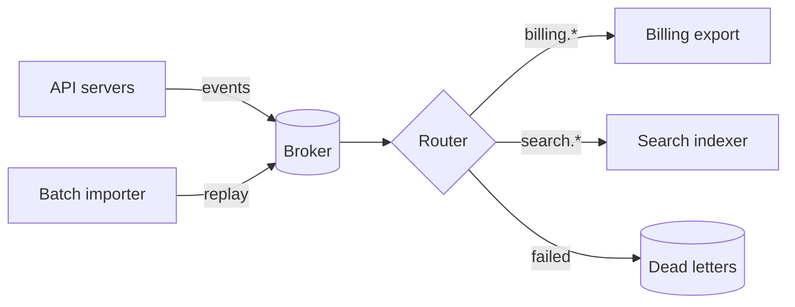

# Ingest Pipeline Migration Plan

Owner: Platform team · Status: In review · Target: Q1

This plan moves batch ingest from the nightly cron job to a streaming
pipeline. It is written for reviewers who want the decisions, the risks,
and the rollout without reading the code. Budget is about $5k per month
today and $8k after the move, so the cost line is not math.

## Contents

- [Goals](#goals)
- [Architecture](#architecture)
- [Capacity model](#capacity-model)
- [Rollout](#rollout)
- [Open questions](#open-questions)

## Goals

- [x] Agree the event schema with the analytics team
- [x] Pick a broker (see [ADR-004](ADR-004.md))
- [ ] Shadow-write for two weeks with no consumer-visible change
- [ ] Cut over consumers one at a time
  - [ ] Billing export
  - [ ] Search indexer
- [ ] Delete the cron job and its alerts

## Architecture

Producers write to the broker; a single consumer group fans out to sinks.
Retries use a dead-letter topic, never an in-process loop.



Each event carries this envelope:

```json
{
  "id": "evt_01HZY3K9V2",
  "type": "billing.invoice.paid",
  "occurred_at": "2026-11-20T09:14:03Z",
  "schema": 3,
  "payload": {
    "invoice_id": "inv_8812",
    "amount_minor": 125000,
    "currency": "EUR"
  }
}
```

## Capacity model

Peak throughput is the daily volume $V$ compressed into the busiest hour
with a burst factor $b$:

$$
\lambda_{peak} = \frac{b \cdot V}{3600} \quad \text{events/s}, \qquad
P = \left\lceil \frac{\lambda_{peak}}{\mu} \right\rceil
$$

where $\mu \approx 2{,}000$ events/s is one partition's sustained rate and
$P$ is the partition count. With $V = 1.8 \times 10^{8}$ and $b = 4$, we get
$\lambda_{peak} = 200{,}000$ and $P = 100$.

| Stage | Owner | Current (batch) | Target (stream) | p99 latency budget | Failure handling | Notes |
|:------|:------|----------------:|----------------:|:------------------:|:-----------------|:------|
| Producer | API team | n/a | 200k events/s | 15 ms | Local buffer, 30 s | Backpressure returns `429` to callers |
| Broker | Platform | n/a | 100 partitions | 25 ms | 3 replicas, rack-aware | Retention 7 days, compacted keys |
| Billing export | Finance eng | 6 h nightly | 2 min | 120 s | Dead-letter + page | Must stay idempotent on `id` |
| Search indexer | Search | 24 h | 30 s | 30 s | Dead-letter, no page | Reindex job remains as fallback |
| Dead letters | Platform | n/a | < 0.01 % | n/a | Manual replay tool | Alert above 100 per hour |

## Rollout

1. **Shadow.** Producers write to both paths; consumers still read batch.
2. **Compare.** A daily diff job checks row counts and checksums.
3. **Cut over.** One consumer per week, behind a flag.
4. **Remove.** Delete the cron job after 30 clean days.

> [!WARNING]
> Billing must not double-count during cut-over. The consumer keys on
> `id`, and the batch job is disabled for billing in the same deploy.

## Open questions

1. Do we need cross-region replication in v1, or is single-region with
   backups enough?
2. Who owns the replay tool after launch?

---

Glossary: *partition* — an ordered shard of a topic; **consumer group** —
consumers sharing one read position; ~~exactly-once~~ effectively-once.
