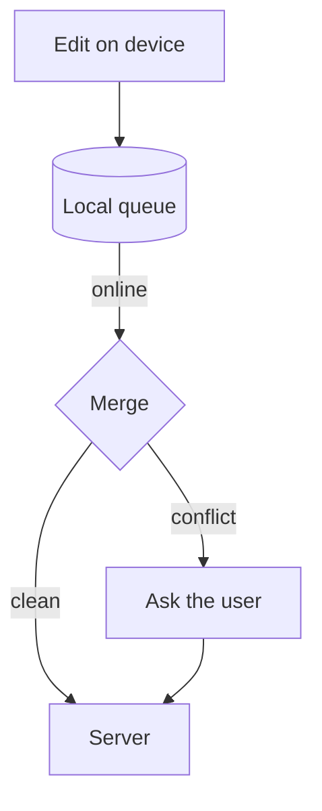

# Launch Review: Offline Sync

**Owner:** Mobile team · **Status:** In review · **Ship date:** 14 March

Offline Sync lets people keep working on a plane, in a tunnel, or anywhere the
network drops. Edits queue locally and merge when the device reconnects, with
*no* conflicts lost and **nothing** overwritten silently.

## Launch checklist

- [x] Merge engine passes the conflict corpus
- [x] Battery impact under 2 % per hour of sync
- [x] Accessibility review signed off
- [ ] Rollout to 10 % of iPhone users
- [ ] Support article published
  - [ ] Screenshots for the help centre

## How sync works



Each change carries a vector clock, so the merge can tell concurrent edits
from sequential ones:

$$
\text{concurrent}(a, b) \iff \neg(a \le b) \land \neg(b \le a)
$$

## Rollout plan

| Stage | Audience | Duration | Exit criteria |
|:------|:---------|---------:|:--------------|
| Internal | Staff devices | 1 week | Zero data-loss reports |
| Beta | 5 % of users | 2 weeks | Crash-free rate ≥ 99.8 % |
| General | Everyone | — | Support tickets flat |

> [!NOTE]
> The rollout pauses automatically if the crash-free rate drops below target.

## API

```swift
let queue = SyncQueue(store: .local)
try await queue.enqueue(edit)
for await result in queue.merges {
    if case .conflict(let both) = result { await ask(both) }
}
```

See the [design doc](design.md) and the [merge corpus](tests/corpus.md) for details.[^1]

[^1]: The corpus has 2,400 real conflicts collected during the beta.
